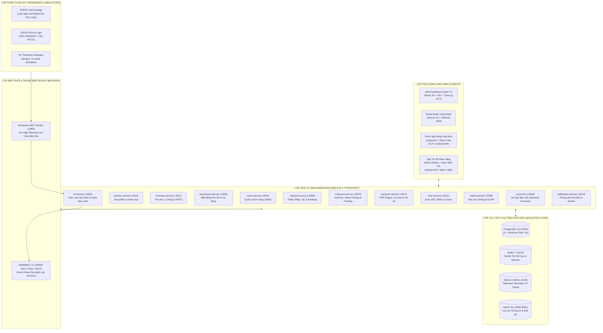

# 🛒 CityMart - Smart Food Warehouse Management System (SFWMS)

<div align="center">

[](https://nestjs.com/)
[](https://react.dev/)
[](https://nextjs.org/)
[](https://expo.dev/)
[](https://www.typescriptlang.org/)
[](https://www.postgresql.org/)
[](https://www.rabbitmq.com/)
[](https://mosquitto.org/)
[](https://threejs.org/)
[](https://www.docker.com/)

**Hệ thống Quản lý Kho Vận Thực phẩm Thông minh CityMart (SFWMS)**  
*Giải pháp chuyển đổi số toàn diện cho chuỗi cung ứng thực phẩm tươi sống, lạnh & đông lạnh kết hợp Microservices, Digital Twin 3D, IoT Chuỗi lạnh, Chiến lược FEFO và Tối ưu Định tuyến VRP.*

[📖 Xem Cẩm nang Khởi chạy (RUN GUIDE)](./RUN_GUIDE.md) • [👥 Danh sách Tài khoản Test](./docs/DANH_SACH_TAI_KHOAN.md) • [🎨 Quy chuẩn Thiết kế UI/UX](./docs/QUY_CHUAN_THIET_KE_GIAO_DIEN.md) • [☁️ Hướng dẫn Deploy EC2](./docs/HUONG_DAN_DEPLOY_EC2.md)

</div>

---

## 📑 Mục lục
1. [Giới thiệu tổng quan](#-giới-thiệu-tổng-quan)
2. [5 Trụ cột Công nghệ Đột phá](#-5-trụ-cột-công-nghệ-đột-phá)
3. [Kiến trúc hệ thống (System Architecture)](#-kiến-trúc-hệ-thống)
4. [Hệ sinh thái Đa nền tảng (Ecosystem)](#-hệ-sinh-thái-đa-nền-tảng)
5. [Bảng Công nghệ sử dụng (Tech Stack)](#-công-nghệ-sử-dụng)
6. [Yêu cầu Môi trường & Khởi động Nhanh](#-hướng-dẫn-cài-đặt--khởi-chạy)
7. [Danh mục Microservices & Cổng kết nối (Ports)](#-danh-mục-microservices--cổng-kết-nối)
8. [Tài khoản Thử nghiệm (Demo Accounts)](#-tài-khoản-thử-nghiệm-demo-accounts)
9. [Cấu trúc Thư mục Dự án Monorepo](#-cấu-trúc-thư-mục-dự-án)
10. [Xử lý Sự cố Thường gặp (Troubleshooting)](#-xử-lý-sự-cố-thường-gặp)

---

## 🌟 Giới thiệu tổng quan

Ngành kho vận thực phẩm tươi mát và đông lạnh đối mặt với 3 thách thức sống còn: **Hạn sử dụng ngắn**, **Rủi ro đứt gãy chuỗi lạnh (Cold-Chain break)** và **Chi phí giao hàng chặng cuối (Last-mile delivery) đắt đỏ**.

**CityMart SFWMS** được thiết kế như một nền tảng quản trị kho thông minh chuẩn công nghiệp (Enterprise Grade), giải quyết triệt để các bài toán trên thông qua việc số hóa toàn trình từ khâu Nhập kho (Inbound QC), Lưu trữ (Putaway), Giám sát nhiệt độ thời gian thực (IoT Cold-Chain), Soạn hàng (FEFO & Pick-to-Light) đến Điều phối giao hàng chặng cuối (Vehicle Routing Problem).

---

## 🚀 5 Trụ cột Công nghệ Đột phá

### 1. 🏢 Digital Twin 3D Kho Vận (Three.js / React Three Fiber)
- Số hóa không gian kho hàng 3D trực quan theo tỉ lệ thực (Kho Gò Vấp, Thủ Đức, Quận 12...).
- Hiển thị trực quan từng dãy kệ (Racks), ô chứa hàng (Bins), tầng lưu trữ (Levels) và tình trạng đầy tải (Utilization Rate).
- Tích hợp lớp bản đồ nhiệt độ (Thermal Heatmap) đổi màu theo thời gian thực tương ứng với cảm biến môi trường.

### 2. ❄️ IoT Giám sát Chuỗi lạnh & Cảnh báo Sớm (Cold-Chain Telemetry)
- Kết nối cảm biến phần cứng thật **ESP32** (DHT22/SHT30) và các trạm mô phỏng qua giao thức **MQTT (Mosquitto)**.
- Phân vùng nhiệt độ nghiêm ngặt: **Kho Đông Sâu (-18°C đến -22°C)**, **Kho Mát (0°C đến 4°C)**, **Kho Rau Củ Quả (8°C đến 12°C)** và **Kho Khô (20°C đến 25°C)**.
- Tự động kích hoạt chuông cảnh báo và gửi thông báo khẩn cấp khi phát hiện nhiệt độ vượt ngưỡng quá 60 giây (hở cửa kho, hỏng máy lạnh).

### 3. 📦 Quản trị Hạn dùng theo Lô & Thuật toán FEFO (First Expired, First Out)
- Quản lý định danh từng lô hàng: `LOT-EM-[SKU]-[WH]-[YYYYMMDD]-[BATCH]`.
- Tự động đề xuất vị trí lấy hàng ưu tiên lô có hạn dùng gần nhất, giảm thiểu tối đa tỷ lệ hủy hàng do hết date.
- Phân loại trạng thái hàng hóa theo quy chuẩn an toàn thực phẩm: **Tươi mới (Fresh)**, **Cảnh báo cận date (Warning)** và **Cách ly (Quarantine)**.

### 4. 💡 Soạn hàng Thông minh Pick-to-Light kết hợp Cân Điện tử
- Kết nối hệ thống đèn LED WS2812B trên từng kệ hàng và module cảm biến trọng lượng HX711 (Loadcell).
- Đèn LED sáng chỉ dẫn đúng vị trí cần nhặt; nhân viên nhặt hàng và cân kiểm tra trọng lượng tự động xác nhận số lượng mà không cần thao tác bấm nút thủ công.

### 5. 🚚 Tối ưu Lộ trình Giao hàng Đa điểm (Vehicle Routing Problem - VRP)
- Thuật toán Heuristic giải bài toán định tuyến VRP có ràng buộc: Ràng buộc thời gian giao (Time Windows), Dung tích xe tải (Capacity), Phân loại xe thùng lạnh và xe tiêu chuẩn.
- Gom cụm đơn hàng (Clustering) tự động, tính toán lộ trình tiết kiệm quãng đường và nhiên liệu nhất, tích hợp bản đồ số dẫn đường cho tài xế.

---

## 🏛️ Kiến trúc hệ thống

Hệ thống được thiết kế theo mô hình **Monorepo Workspaces** với kiến trúc **Event-Driven Microservices** độc lập, kết nối bất đồng bộ qua **RabbitMQ** và **Mosquitto MQTT**:



---

## 📱 Hệ sinh thái Đa nền tảng

| Phân hệ ứng dụng | Công nghệ nền tảng | Cổng mặc định | Người dùng đích & Nghiệp vụ trọng tâm |
| :--- | :--- | :---: | :--- |
| **Web Dashboard** | React 19, Vite, Tailwind, Three.js | `5173` | **Ban Giám đốc & Quản lý Kho**: Điều phối trực quan 3D, duyệt phiếu, theo dõi KPI và cảnh báo sự cố chuỗi lạnh. |
| **Customer Web** | Next.js 16 (App Router), Tailwind CSS | `3000` | **Khách hàng B2B / B2C**: Mua sắm thực phẩm online, theo dõi tiến độ đơn hàng và thời gian giao hàng dự kiến. |
| **Staff App (PDA)** | React Vite, Capacitor / Ionic | `5174` (hoặc APK) | **Nhân viên Kho**: Quét mã vạch nhận hàng Inbound, kiểm định QC, lấy hàng theo đợt (Wave Picking) tại kệ. |
| **Driver App** | React Native, Expo SDK 54 | `8081` (hoặc APK) | **Tài xế Vận chuyển**: Nhận danh sách đơn, xem tuyến đường VRP tối ưu trên bản đồ, chụp ảnh ký nhận POD. |
| **IoT Hardware** | C/C++ PlatformIO / Arduino (ESP32) | Phần cứng thật | Giám sát nhiệt ẩm phòng lạnh, hiển thị màn hình OLED, điều khiển đèn Pick-to-Light và cân kiểm trọng lượng. |

---

## 🛠️ Công nghệ sử dụng

| Tầng kiến trúc | Chi tiết công nghệ |
| :--- | :--- |
| **Backend Core** | NestJS 10, TypeScript 5, TypeORM, Passport JWT, Class-Validator, Swagger OpenAPI |
| **Frontend Web** | React 19, Next.js 16, Vite, Tailwind CSS 3, Lucide React, React-Three-Fiber / Three.js, Recharts |
| **Mobile Development** | React Native, Expo 54, Capacitor 5, Ionic Core, Android Native Toolchain (Gradle) |
| **Data Storage** | PostgreSQL 15 (Relational Data), Redis 7 (Caching & Locking), SQLite 3 (IoT Local Buffer), MinIO (Object Storage) |
| **Event Bus & Messaging** | RabbitMQ 3.12 (AMQP Protocol), Eclipse Mosquitto (MQTT Protocol), WebSockets / Socket.io |
| **DevOps & Tooling** | Docker, Docker Compose, Nginx Reverse Proxy, Concurrently, npm workspaces |

---

## 🚀 Hướng dẫn cài đặt & Khởi chạy

### Bước 1: Clone kho mã nguồn
```bash
git clone https://github.com/Chituongnguyen24/SmartWarehouse.git
cd SmartWarehouse
```

### Bước 2: Cài đặt thư viện dependencies
Chạy lệnh cài đặt từ thư mục gốc cho toàn bộ các workspace:
```bash
npm run install:all
```

---

### Bước 3: Khởi động cụm hạ tầng Docker
Khởi tạo tự động PostgreSQL, Redis, RabbitMQ, Mosquitto và MinIO:
```bash
npm run infra:up
```
> [!NOTE]
> Database PostgreSQL sẽ tự động nạp cấu trúc bảng và ràng buộc thông qua script `scripts/init-db.sql`. Đảm bảo các container hiển thị trạng thái `healthy` trước khi chạy bước tiếp theo.

---

### Bước 4: Nạp dữ liệu mẫu hoàn chỉnh (Curated Seed Data)
Chỉ với 3 câu lệnh ngắn gọn để nạp đầy đủ dữ liệu demo khớp 100% với kịch bản bảo vệ đồ án:

```bash
# 1. Nạp danh mục hơn 5.000 sản phẩm siêu thị chính hãng
npm run seed:products

# 2. Nạp dữ liệu người dùng chuẩn và phân quyền 6 vai trò
npm run seed:users

# 3. Nạp kịch bản demo bảo vệ khóa luận (130 sản phẩm tiêu biểu khớp 26 kệ 3D, Lô FEFO, Đơn hàng, Phiếu Nhập/Xuất)
npm run seed:demo
```

---

### Bước 5: Khởi chạy Backend Microservices

Bạn có thể lựa chọn 1 trong 2 phương án tùy thuộc vào dung lượng RAM máy tính:

#### Cách A: Chạy toàn bộ 9 Services cùng lúc (Khuyến nghị RAM >= 16GB)
```bash
npm run backend:all
```

#### Cách B: Chạy phân tách theo nhóm nghiệp vụ (Tiết kiệm tài nguyên)
```bash
# Terminal 1 - Nhóm Kho & Nghiệp vụ (User, Outbound, Product, Inventory, Inbound, IoT)
npm run backend:staff

# Terminal 2 - Nhóm Quản trị & Điều phối (Warehouse, Order, Report, Transport)
npm run backend:admin
```

---

### Bước 6: Khởi chạy Ứng dụng Giao diện

#### 1. Web Dashboard Quản trị (Admin / Manager)
```bash
npm run dashboard:start
```
👉 Truy cập: **[http://localhost:5173](http://localhost:5173)**

#### 2. Cổng Web Mua sắm Khách hàng (Customer Web)
```bash
npm run customer-web:start
```
👉 Truy cập: **[http://localhost:3000](http://localhost:3000)**

#### 3. Bộ Giả lập Cảm biến IoT Chuỗi lạnh (Simulator)
```bash
npm run start -w simulators
```
*Tự động phát dữ liệu nhiệt độ/độ ẩm định kỳ lên MQTT Broker `localhost:1883` và kích hoạt kịch bản cảnh báo hở cửa kho lạnh.*

---

## 🌐 Danh mục Microservices & Cổng kết nối

### Danh sách Dịch vụ Backend
| Tên Service | Port | Endpoint Mặc định | Swagger API Docs | Vai trò nghiệp vụ |
| :--- | :---: | :--- | :--- | :--- |
| **user-service** | `3012` | `http://localhost:3012` | `http://localhost:3012/api` | Xác thực JWT, Quản lý tài khoản, Phân quyền RBAC |
| **product-service** | `3010` | `http://localhost:3010` | `http://localhost:3010/api` | Danh mục thực phẩm, SKU, Đơn vị tính, Quy cách |
| **inventory-service** | `3011` | `http://localhost:3011` | `http://localhost:3011/api` | Tồn kho thời gian thực, Quản lý Lô hàng & Chiến lược FEFO |
| **warehouse-service** | `3005` | `http://localhost:3005` | `http://localhost:3005/api` | Không gian kho 3D Digital Twin, Cấu hình Kệ, Vị trí Ô |
| **order-service** | `3004` | `http://localhost:3004` | `http://localhost:3004/api` | Quản lý Đơn hàng B2B/B2C (OMS), Luồng duyệt đơn |
| **inbound-service** | `3006` | `http://localhost:3006` | `http://localhost:3006/api` | Quy trình Nhập kho, Kiểm định chất lượng (QC), Cất hàng |
| **outbound-service** | `3007` | `http://localhost:3007` | `http://localhost:3007/api` | Xuất kho, Wave Picking, Đóng gói niêm phong & Pick-to-Light |
| **transport-service** | `3013` | `http://localhost:3013` | `http://localhost:3013/api` | Tối ưu hóa lộ trình xe (VRP Engine), Điều phối Tài xế |
| **iot-service** | `3002` | `http://localhost:3002` | `http://localhost:3002/api` | Thu thập gói tin MQTT, Phân tích nhiệt độ, Kích hoạt cảnh báo |
| **report-service** | `3008` | `http://localhost:3008` | `http://localhost:3008/api` | Tổng hợp KPI, Báo cáo hao hụt, Xuất file PDF/Excel |
| **ai-service** | `3003` | `http://localhost:3003` | `http://localhost:3003/api` | Dự báo nhu cầu nhập hàng thông minh (Demand Forecasting) |

### Cổng Dịch vụ Hạ tầng
| Dịch vụ | Cổng | Giao thức / Đường dẫn | Thông tin xác thực mặc định |
| :--- | :---: | :--- | :--- |
| **PostgreSQL** | `5432` | `postgresql://localhost:5432` | User: `postgres` / Pass: `postgres` |
| **RabbitMQ Console** | `15672` | `http://localhost:15672` | User: `guest` / Pass: `guest` |
| **Mosquitto MQTT** | `1883` | `mqtt://localhost:1883` | Kết nối mở / Client ID ẩn danh |
| **Redis Cache** | `6379` | `redis://localhost:6379` | Không yêu cầu mật khẩu |
| **MinIO Console** | `9001` | `http://localhost:9001` | User: `sfwms_minio` / Pass: `sfwms_minio_2026` |

---

## 🔑 Tài khoản Thử nghiệm (Demo Accounts)

Tất cả tài khoản thử nghiệm sử dụng mật khẩu chung: `password123`

| Vai trò (Role) | Email đăng nhập | Phân hệ truy cập chính | Thẩm quyền đại diện |
| :--- | :--- | :--- | :--- |
| 👑 **ADMIN** | `admin@sfwms.vn` | Web Dashboard | Toàn quyền kiểm soát hệ thống, Cấu hình phân quyền & Giám sát tổng thể. |
| 🏢 **WAREHOUSE_MANAGER** | `manager_govap@sfwms.vn` | Web Dashboard | Quản lý mặt bằng kho 3D Gò Vấp, Duyệt xuất/nhập, Cảnh báo nhiệt độ IoT. |
| 👷 **WAREHOUSE_STAFF** | `staff@sfwms.vn` | Staff App / PDA | Thực hiện kiểm hàng QC, Soạn hàng theo chỉ dẫn FEFO, Đóng thùng xuất kho. |
| 💼 **SALES_STAFF** | `sales@sfwms.vn` | Web Dashboard | Quản lý đơn hàng sỉ/lẻ B2B, Theo dõi tồn kho thực tế và hạn dùng sản phẩm. |
| 🚚 **DRIVER** | `driver@sfwms.vn` | Driver App | Tiếp nhận lệnh xe, Xem bản đồ tối ưu đường đi VRP, Cập nhật trạng thái giao. |
| 🛒 **CUSTOMER** | `customer@sfwms.vn` | Customer Web | Đặt mua hàng thực phẩm, Theo dõi tình trạng chuẩn bị đơn và hành trình xe. |

---

## 📂 Cấu trúc Thư mục Dự án

```
SmartWarehouse/
├── backend/
│   └── services/              # 12 Microservices hoạt động độc lập (NestJS)
│       ├── ai-service/        # Dự báo nhu cầu AI
│       ├── inbound-service/   # Nhập hàng & QC
│       ├── inventory-service/ # Quản lý lô & FEFO
│       ├── iot-service/       # Thu thập & Cảnh báo IoT
│       ├── notification-service/
│       ├── order-service/     # Quản lý đơn hàng (OMS)
│       ├── outbound-service/  # Xuất kho, Picking & Packing
│       ├── product-service/   # Danh mục hàng hóa
│       ├── report-service/    # Thống kê & Báo cáo
│       ├── transport-service/ # Định tuyến VRP & Vận tải
│       ├── user-service/      # Xác thực & Phân quyền
│       └── warehouse-service/ # Mặt bằng 3D & Kệ hàng
├── docs/                      # Tài liệu bàn giao & Luận văn chính thức
│   ├── Co_So_Ly_Thuyet.md     # Cơ sở lý thuyết đồ án
│   ├── DANH_SACH_TAI_KHOAN.md # Bảng tài khoản chi tiết các kho
│   ├── HUONG_DAN_DEPLOY_EC2.md# Cẩm nang triển khai AWS Cloud
│   ├── QUY_CHUAN_THIET_KE_GIAO_DIEN.md # Tiêu chuẩn UI/UX Enterprise
│   ├── C4-lv2.png             # Sơ đồ kiến trúc mức Container C4
│   └── *.docx                 # Hồ sơ tài liệu thuyết minh
├── firmware/                  # Mã nguồn nhúng cho phần cứng ESP32 thật
│   ├── esp32-cold-storage/    # Giám sát nhiệt ẩm phòng lạnh qua MQTT
│   └── esp32-pick-to-light/   # Đèn LED WS2812B & Cân tải trọng HX711
├── frontend/                  # Các ứng dụng giao diện đa nền tảng
│   ├── customer-web/          # Cổng mua hàng trực tuyến (Next.js 16)
│   ├── driver-app/            # App tài xế giao hàng (React Native Expo)
│   ├── staff-app/             # App nhân viên kho (Capacitor / PDA)
│   └── web-dashboard/         # Cổng điều hành kho 3D (React 19 + Three.js)
├── releases/                  # Bản cài đặt ứng dụng nộp kèm
│   └── driver-app-debug.apk   # File cài đặt Android cho Tài xế
├── scripts/                   # Bộ công cụ vận hành & Seed dữ liệu chuẩn hóa
│   ├── data/                  # Dữ liệu sản phẩm mẫu (products.json, emart_products.json)
│   ├── init-db.sql            # Script khởi tạo 11 databases trên PostgreSQL
│   ├── benchmark-vrp-oms.js   # Script đo đạc hiệu năng Throughput & Latency
│   ├── seed_products.js       # Nạp sản phẩm vào database
│   ├── seed_demo_users.js     # Nạp tài khoản và mật khẩu
│   ├── seed_full_demo.js      # Nạp kịch bản demo bảo vệ khóa luận (26 kệ 3D, lô FEFO...)
│   ├── mqtt_monitor.js        # Giám sát gói tin MQTT thời gian thực
│   └── build-mobile-apps.js   # Tự động hóa đóng gói APK
├── simulators/                # Bộ giả lập IoT phục vụ chạy thử nghiệm
│   ├── iot-simulator.ts       # Giả lập phát tín hiệu nhiệt ẩm kho lạnh
│   └── wokwi-pick-to-light/   # Giả lập Pick-to-Light trên nền tảng Wokwi
├── docker-compose.yml         # Thiết lập hạ tầng Docker cục bộ
├── package.json               # Cấu hình Monorepo Workspaces & Scripts
├── README.md                  # Tài liệu giới thiệu tổng quan dự án
├── RUN_GUIDE.md               # Cẩm nang câu lệnh khởi chạy từng bước
└── sfwms_iot.db               # SQLite database cho dịch vụ IoT Telemetry
```

---

## ❓ Xử lý Sự cố Thường gặp

### 1. Lỗi cổng bị chiếm dụng (`EADDRINUSE: :::3004` hoặc `:::5173`)
Nếu một tiến trình cũ chưa giải phóng cổng mạng, chạy lệnh sau trên PowerShell:
```powershell
# Tìm tiến trình đang chiếm cổng (ví dụ cổng 3004)
Get-NetTCPConnection -LocalPort 3004 | Select-Object OwningProcess

# Buộc dừng tiến trình (thay <PID> bằng số tìm thấy)
Stop-Process -Id <PID> -Force
```

### 2. Khởi động PostgreSQL nhưng Service chưa kết nối được
Khi khởi chạy lần đầu tiên qua Docker, PostgreSQL cần nạp script SQL `init-db.sql` trong 5-15 giây. Hãy kiểm tra trạng thái bằng lệnh:
```bash
docker ps
```
Khi container `sfwms-postgres` chuyển sang trạng thái `(healthy)`, bạn có thể yên tâm chạy các câu lệnh nạp dữ liệu và khởi động microservices.

### 3. Đảo cổng kết nối USB cho Ứng dụng Di động (Driver & Staff App)
Khi kết nối điện thoại Android qua cáp USB để kiểm thử:
```bash
adb reverse tcp:8081 tcp:8081
adb reverse tcp:3004 tcp:3004
adb reverse tcp:3007 tcp:3007
adb reverse tcp:3012 tcp:3012
```

---

## 🎓 Thông tin Đồ án & Bản quyền

- **Đề tài**: Hệ thống Quản lý Kho Thực phẩm Thông minh (Smart Food Warehouse Management System - SFWMS).
- **Phạm vi**: Khóa luận Tốt nghiệp Đại học - Chuyên ngành Kỹ thuật Phần mềm / Hệ thống Thông tin.
- **Bản quyền**: © 2026 CityMart SmartWarehouse Team. Mã nguồn mở phục vụ mục đích nghiên cứu và giáo dục.
