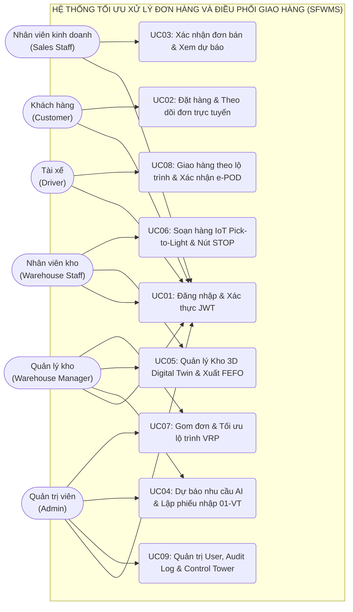
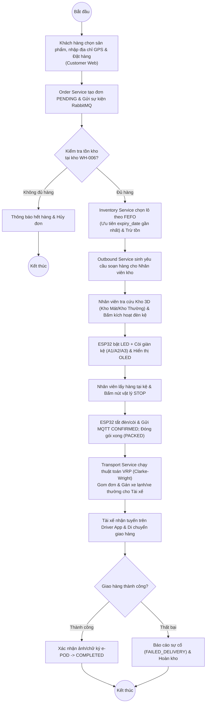
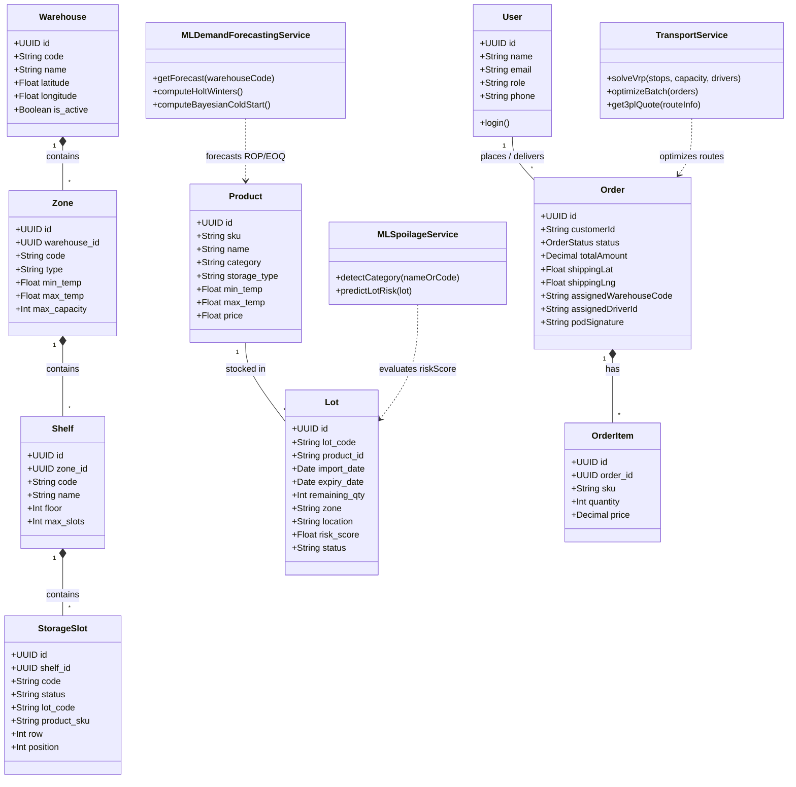
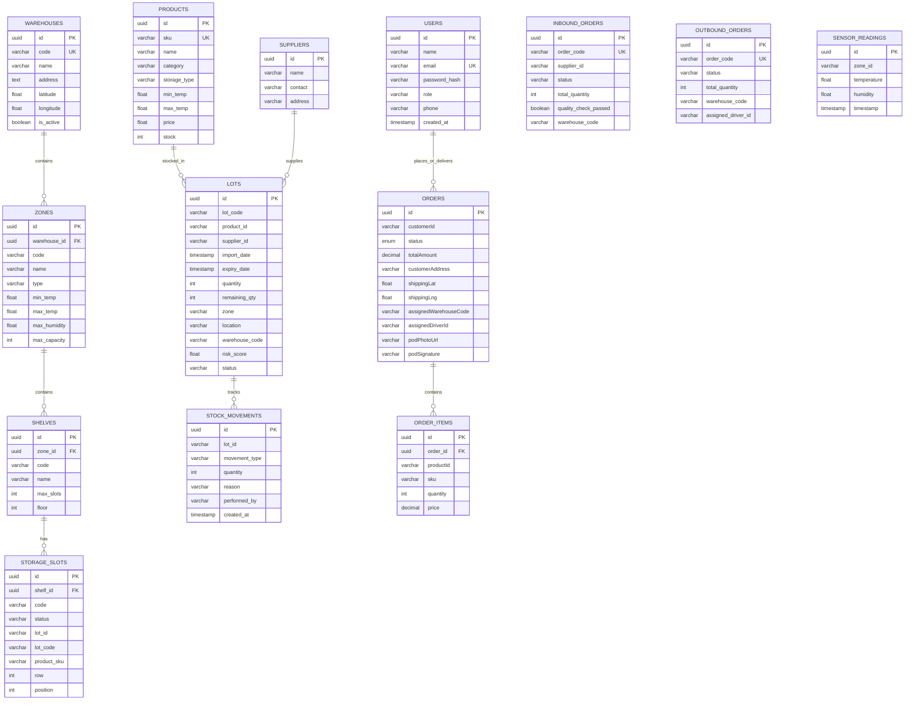
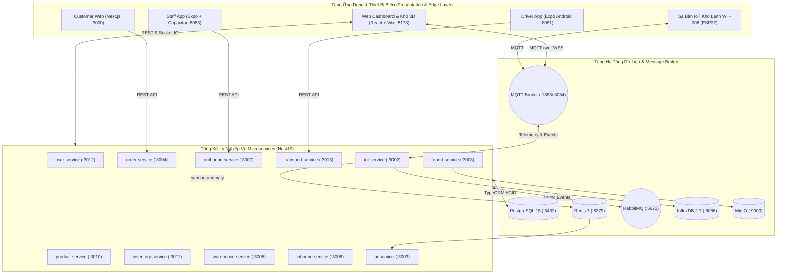
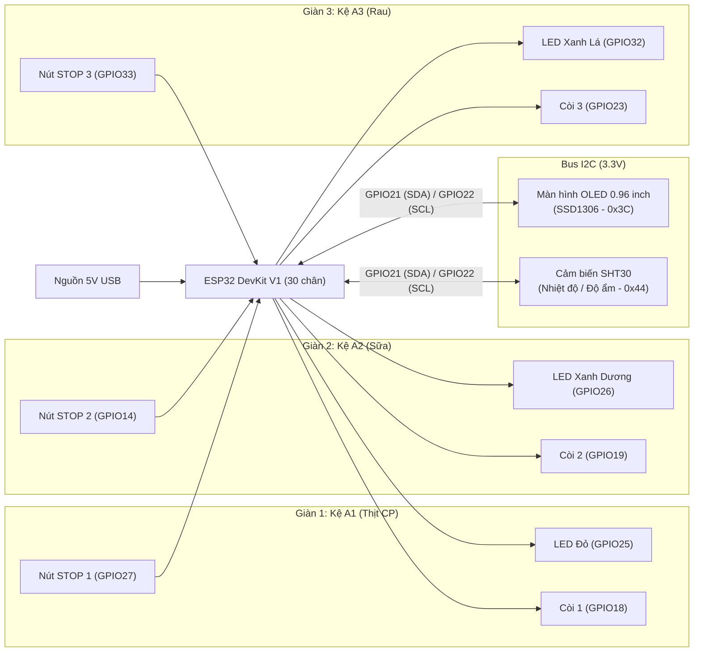

# CHƯƠNG 3: THU THẬP, PHÂN TÍCH VÀ THIẾT KẾ HỆ THỐNG

---

## 3.1. Khảo sát và thu thập yêu cầu

### 3.1.1. Một số kế hoạch thực hiện

Để xây dựng một giải pháp quản lý kho hàng thông minh và điều phối giao nhận sát với thực tế vận hành của các siêu thị thực phẩm tại TP. Hồ Chí Minh, nhóm thực hiện đã lập kế hoạch khảo sát và thu thập yêu cầu theo lộ trình gồm 04 giai đoạn trọng tâm:

* **Giai đoạn 1 – Khảo sát quy trình vận hành thực tế tại siêu thị (Mô hình CityMart – Kho trung tâm Gò Vấp `WH-006`):** Nghiên cứu cấu trúc lưu trữ hàng hóa theo **02 phân khu nhiệt độ tiêu chuẩn** gồm **Kho Mát (`COLD` / `COOL`)** duy trì từ `0°C` đến `+4°C` và **Kho Thường (`DRY`)** duy trì ở nhiệt độ phòng (`15°C – 30°C`); khảo sát quy trình nhập hàng, kiểm định chất lượng (QC), sắp xếp lên kệ, soạn đơn (Picking), đóng gói (Packing) và bàn giao cho tài xế.
* **Giai đoạn 2 – Phỏng vấn nghiệp vụ các đối tượng sử dụng:** Thu thập khó khăn và nhu cầu thực tế từ 06 nhóm tác nhân: Quản trị viên (`ADMIN`), Quản lý kho (`WAREHOUSE_MANAGER`), Nhân viên kho (`WAREHOUSE_STAFF`), Nhân viên kinh doanh (`SALES_STAFF`), Tài xế giao hàng (`DRIVER`) và Khách hàng (`CUSTOMER`).
* **Giai đoạn 3 – Khảo sát thực địa thiết bị IoT và sa bàn kho lạnh:** Đánh giá khả năng triển khai phần cứng chi phí thấp sử dụng vi điều khiển **ESP32 DevKit V1**, cảm biến nhiệt độ – độ ẩm **SHT30**, màn hình **OLED SSD1306 0.96"** và hệ thống **Pick-to-Light** gồm 3 giàn kệ (`A1 – Thịt CP`, `A2 – Sữa`, `A3 – Rau`) tích hợp LED, còi cảnh báo và nút bấm vật lý `STOP`.
* **Giai đoạn 4 – Tổng hợp dữ liệu chuẩn hóa và đặc tả bài toán tối ưu:** Chuẩn hóa dữ liệu sản phẩm thực tế (hạn sử dụng, ngưỡng nhiệt độ, tọa độ GPS các quận tại TP. Hồ Chí Minh) để xây dựng mô hình toán học cho bài toán **FEFO + Arrhenius**, **Holt-Winters + Bayesian Cold-Start** và **VRP Clarke-Wright Savings**.

### 3.1.2. Một số kết quả thu thập

Sau quá trình khảo sát và phân tích dữ liệu, nhóm thực hiện rút ra các kết quả thực trạng và yêu cầu cốt lõi cần giải quyết:

1. **Phân tách rõ ràng 02 phân khu bảo quản hàng hóa:**
   * **Kho Mát (`COLD` / `COOL`, `0°C – +4°C`, độ ẩm `60% – 85%`):** Chứa các sản phẩm nhạy cảm với nhiệt độ và có vòng đời ngắn (2–14 ngày) như Thịt tươi sống & Gia cầm (Giàn kệ `A1`), Sữa tươi & Chế phẩm bơ sữa (Giàn kệ `A2`), Rau củ quả VietGAP (Giàn kệ `A3`).
   * **Kho Thường (`DRY`, `15°C – 30°C`):** Chứa các mặt hàng khô, lương thực, mì gói, đồ hộp và gia vị.
2. **Đứt gãy thông tin tồn kho và xử lý đơn hàng chậm:** Khi khách đặt hàng trực tuyến, việc kiểm tra tồn kho và soạn hàng theo giấy in thủ công mất trung bình nhiều phút cho mỗi đơn, dễ dẫn đến xuất nhầm lô hàng mới thay vì lô cận date.
3. **Thất thoát thực phẩm do thiếu giám sát nhiệt độ và hạn sử dụng:** Chỉ cần cửa kho mát mở lâu hoặc máy làm lạnh trục trặc khiến nhiệt độ vượt ngưỡng `+4.5°C`, tốc độ hư hỏng của thịt và sữa tăng theo hàm mũ nhưng các phần mềm truyền thống chỉ quản lý số lượng tĩnh mà không tính tới rủi ro nhiệt độ.
4. **Chi phí giao nhận chặng cuối cao:** Việc điều phối tài xế theo kinh nghiệm cá nhân khiến lộ trình di chuyển nội đô TP.HCM bị chồng chéo, thiếu kiểm soát tải trọng xe và không tách biệt xe bảo quản lạnh (`REFRIGERATED`) với xe thường (`NORMAL`).

---

## 3.2. Phân tích yêu cầu

### 3.2.1. Yêu cầu chức năng

Hệ thống được phân tích theo mô hình phân quyền 06 tác nhân (RBAC), đáp ứng đầy đủ **17 yêu cầu chức năng (`FR-01` đến `FR-17`)** thuộc 06 phân hệ chính như trình bày trong Bảng 3.1 và Bảng 3.2.

*Bảng 3.1. Danh sách tác nhân và phân quyền sử dụng hệ thống SFWMS*

| STT | Mã Vai trò (`Role`) | Tên Tác nhân | Trách nhiệm & Phạm vi chức năng chính | Nền tảng |
|:---:|:---|:---|:---|:---|
| 1 | `ADMIN` | Quản trị viên | Toàn quyền quản lý người dùng, phân quyền RBAC, danh mục SKU gốc, nhà cung cấp, Tháp điều khiển (`Control Tower`) và `Audit Log`. | Web Dashboard |
| 2 | `WAREHOUSE_MANAGER` | Quản lý kho | Điều hành kho được gán (`WH-006`); duyệt phiếu nhập/xuất, xem dự báo AI, giám sát Kho 3D Digital Twin và điều phối tuyến giao VRP. | Web Dashboard |
| 3 | `WAREHOUSE_STAFF` | Nhân viên kho | Nhận đơn chờ đóng gói; tra cứu kệ trên Sơ đồ 3D/2D; bật đèn định vị kệ IoT (`Pick-to-Light`), nhấn nút `STOP` tại kệ và bàn giao tài xế. | Web Dashboard, `Staff App`, Sa bàn ESP32 |
| 4 | `SALES_STAFF` | Nhân viên kinh doanh | Xác nhận đơn hàng từ khách, kiểm tra tồn khả dụng, theo dõi dự báo nhu cầu tiêu thụ AI. | Web Dashboard |
| 5 | `DRIVER` | Tài xế giao hàng | Nhận tuyến giao tối ưu VRP, theo dõi bản đồ GPS, cập nhật trạng thái giao hàng, thu thập chữ ký/ảnh e-POD hoặc hoàn trả đơn lỗi. | `Driver App` (Android/Expo) |
| 6 | `CUSTOMER` | Khách hàng | Xem sản phẩm theo ngành hàng & Flash Sale, quản lý giỏ hàng, chọn tọa độ giao hàng, đặt hàng và theo dõi tiến độ trực tuyến. | `Customer Web` (Next.js) |

*Bảng 3.2. Tổng hợp yêu cầu chức năng theo từng phân hệ*

| Phân hệ | Mã yêu cầu | Mô tả chi tiết chức năng |
|:---|:---|:---|
| **Mua sắm trực tuyến** | `FR-01` – `FR-03` | Duyệt danh mục thực phẩm, kiểm tra tồn kho khả dụng theo thời gian thực; giỏ hàng & định vị tọa độ GPS giao hàng; đặt đơn và theo dõi 12 trạng thái đơn hàng qua WebSocket. |
| **Nhập kho & Dự báo AI/ML** | `FR-04` – `FR-07` | Dự báo nhu cầu bằng **Holt-Winters Seasonal Smoothing**; xử lý SKU mới bằng **Bayesian Category Prior (Cold-Start)**; tính `Safety Stock`, `ROP`, `EOQ` cùng sai số `MAPE`, `RMSE`, `MAE`, `R²`; tạo và in phiếu nhập chuẩn **Mẫu 01-VT** bằng 1 click. |
| **Tồn kho 3D & FEFO** | `FR-08` – `FR-10` | Dựng bản sao số **Kho 3D Digital Twin** (Kho Mát `COOL` & Kho Thường `DRY`); tính điểm rủi ro **Arrhenius Kinetic**; xuất kho tự động ưu tiên **FEFO**; sinh `Barcode Code128 / QR Code` và kiểm kê nhanh. |
| **Soạn hàng IoT Pick-to-Light** | `FR-11` – `FR-13` | Tự động giữ chỗ lô FEFO khi có đơn; gửi lệnh `LOCATE` qua MQTT bật LED & Còi đúng giàn kệ (`A1`, `A2`, `A3`); bấm nút vật lý **`STOP`** để tắt đèn/còi và gửi sự kiện `CONFIRMED` lên Web; giám sát SHT30 & OLED. |
| **Tối ưu VRP & Tài xế** | `FR-14` – `FR-15` | Gom đơn và tìm lộ trình ngắn nhất từ Depot Gò Vấp bằng **Clarke-Wright Savings** xét tải trọng và loại xe (`REFRIGERATED` / `NORMAL`); hỗ trợ báo giá đối tác 3PL (GHN, Ahamove); ứng dụng `Driver App` xác nhận e-POD & `Reverse Logistics`. |
| **Quản trị & Tháp điều khiển** | `FR-16` – `FR-17` | Giám sát vị trí trực tuyến đội xe trên bản đồ (`Control Tower`), nhật ký kiểm toán (`Audit Log`), cấu hình hệ thống và thống kê KPI doanh thu/hao hụt. |

### 3.2.2. Yêu cầu phi chức năng

*Bảng 3.3. Bảng đặc tả các yêu cầu phi chức năng của hệ thống SFWMS*

| STT | Nhóm yêu cầu | Mã hiệu | Chỉ tiêu kỹ thuật chi tiết |
|:---:|:---|:---|:---|
| 1 | **Hiệu năng** | `NFR-01` | API đọc kết quả dự báo AI từ Pre-computed Cache đạt `< 50 ms`; giao dịch đặt đơn/xuất kho đạt `< 500 ms`; khung cảnh 3D WebGL duy trì mượt mà ($\ge 30$ FPS). |
| 2 | **Độ tin cậy & Toàn vẹn** | `NFR-02` | Giao dịch trừ tồn kho, nhập/xuất tuân thủ chuẩn **ACID** trên PostgreSQL; sử dụng mẫu **Transactional Outbox** và **RabbitMQ** chống mất dữ liệu sự kiện giữa các dịch vụ. |
| 3 | **Bảo mật & Phân quyền** | `NFR-03` | Mật khẩu băm bằng **Bcrypt**; xác thực phiên bằng **JWT**; kiểm soát truy cập API qua `JwtAuthGuard` và `RolesGuard` theo 6 vai trò RBAC; quản lý kho bị khóa theo đúng `warehouseCode`. |
| 4 | **Thời gian thực** | `NFR-04` | Dữ liệu cảm biến SHT30, sự kiện `STOP` từ ESP32 (MQTT QoS 1) và trạng thái đơn hàng (`Socket.IO`) cập nhật lên Web Dashboard với độ trễ `< 2 giây`. |
| 5 | **Khả năng mở rộng** | `NFR-05` | Kiến trúc **12 Microservices** độc lập (*Database-per-Service*), hạ tầng container hóa hoàn toàn bằng **Docker Compose**. |
| 6 | **Tương thích đa nền tảng** | `NFR-06` | Hỗ trợ trình duyệt Web (`React + Vite`, `Next.js`), thiết bị di động Android (`Expo / Capacitor APK`) và phần cứng nhúng `ESP32 DevKit V1`. |

---

## 3.3. Thiết kế hệ thống

### 3.3.1. Sơ đồ Use case tổng quát

Hình 3.1 minh họa sơ đồ Use Case tổng quát thể hiện mối quan hệ tương tác giữa 06 tác nhân và các nhóm chức năng chính trong hệ thống SFWMS.


*Hình 3.1. Sơ đồ Use Case tổng quát hệ thống SFWMS*

### 3.3.2. Các chức năng chính của hệ thống

Phần này đặc tả chi tiết các kịch bản Use Case nghiệp vụ cốt lõi cùng sơ đồ hoạt động tổng thể của hệ thống.

#### a) Đặc tả các Use Case trọng tâm

*Bảng 3.4. Đặc tả Use Case Đặt hàng trực tuyến và Tự động giữ chỗ FEFO*

| Hạng mục | Nội dung chi tiết |
|:---|:---|
| **Tên Use Case** | **UC-02:** Đặt hàng trực tuyến và Phân bổ kho tự động theo FEFO |
| **Tác nhân** | Chính: `CUSTOMER` — Phụ: `order-service`, `inventory-service`, `outbound-service` |
| **Điều kiện tiên quyết** | Khách hàng đã đăng nhập vào `Customer Web`; các mặt hàng trong giỏ còn đủ tồn kho khả dụng. |
| **Luồng sự kiện chính** | 1. Khách hàng thêm sản phẩm vào giỏ, chọn địa chỉ kèm tọa độ GPS (`shippingLat`, `shippingLng`) và nhấn **"Đặt hàng"**.<br>2. `order-service` tạo bản ghi đơn hàng trạng thái `PENDING`, xác định kho phục vụ (`WH-006`).<br>3. `inventory-service` truy vấn các lô hàng (`lots`) có `remaining_qty > 0` sắp xếp tăng dần theo `expiry_date` (**FEFO**) để trừ tồn khả dụng và ghi nhận `stock_movements`.<br>4. `outbound-service` đồng bộ tạo yêu cầu soạn hàng cho Nhân viên kho và phát thông báo thời gian thực qua Socket.IO. |
| **Luồng ngoại lệ** | Nếu tồn kho thực tế không đủ: Hệ thống hoàn tác (rollback) giao dịch và thông báo SKU hết hàng để khách hàng điều chỉnh giỏ. |

*Bảng 3.5. Đặc tả Use Case Dự báo nhu cầu AI/ML và Lập phiếu nhập kho (Mẫu 01-VT)*

| Hạng mục | Nội dung chi tiết |
|:---|:---|
| **Tên Use Case** | **UC-04:** Dự báo nhu cầu tiêu thụ bằng AI/ML và Lập phiếu nhập kho |
| **Tác nhân** | `WAREHOUSE_MANAGER`, `ADMIN` |
| **Luồng sự kiện chính** | 1. Quản lý mở tab **"AI & ML Dự Báo Nhu Cầu Tiêu Thụ"** tại phân hệ Nhập kho (`/inbound`).<br>2. `inbound-service` đọc Pre-computed Cache (`< 50 ms`) hoặc tính lại mô hình: **Holt-Winters Seasonal Smoothing** cho SKU đủ dữ liệu ($\ge 7$ ngày) và **Bayesian Category Prior** cho SKU mới (Cold-Start).<br>3. Hệ thống hiển thị bộ chỉ số sai số (`MAPE`, `RMSE`, `MAE`, `R²`), biểu đồ xu hướng 95% và danh sách SKU cần nhập (`CRITICAL`, `WARNING`) kèm `Safety Stock` và `ROP`.<br>4. Quản lý nhấn **"Tạo Phiếu Nhập (1-Click)"** $\rightarrow$ Hệ thống tự động điền thông tin sản phẩm, số lượng đề xuất và nhà cung cấp vào phiếu nhập chuẩn **Mẫu 01-VT**. |

*Bảng 3.6. Đặc tả Use Case Soạn hàng IoT Pick-to-Light & Kho 3D Digital Twin*

| Hạng mục | Nội dung chi tiết |
|:---|:---|
| **Tên Use Case** | **UC-05 & UC-06:** Tra cứu Kho 3D và Soạn hàng qua hệ thống IoT Pick-to-Light |
| **Tác nhân** | Chính: `WAREHOUSE_STAFF` — Phụ: Bo mạch **ESP32 WH-006**, MQTT Broker |
| **Luồng sự kiện chính** | 1. Nhân viên kho xem vị trí kệ trên **Sơ đồ Kho 3D** (chia 2 phân khu: **Kho Mát `COOL`** và **Kho Thường `DRY`**) với màu cảnh báo rủi ro **Arrhenius Kinetic**.<br>2. Nhân viên chọn kệ cần lấy hàng (VD: `A1 – Thịt CP`, `A2 – Sữa`, `A3 – Rau`) và bấm **"Bật Đèn Kệ (ESP32)"**.<br>3. Web Dashboard gửi lệnh `LOCATE` qua MQTT tới ESP32; mạch lập tức bật sáng **LED** (`HIGH`), phát **còi nhịp** (`LOW`) và hiện tên kệ cần lấy lên **OLED 0.96"**.<br>4. Nhân viên lấy đúng hàng tại kệ và nhấn nút vật lý **`STOP`** trên giàn kệ đó.<br>5. ESP32 tắt ngay đèn & còi, hiển thị `"KE ... OK"` lên OLED và gửi sự kiện `CONFIRMED` qua MQTT đồng bộ về Web Dashboard. |

*Bảng 3.7. Đặc tả Use Case Gom đơn và Tối ưu lộ trình giao nhận VRP*

| Hạng mục | Nội dung chi tiết |
|:---|:---|
| **Tên Use Case** | **UC-07 & UC-08:** Gom đơn VRP Clarke-Wright Savings và Giao hàng e-POD |
| **Tác nhân** | `WAREHOUSE_MANAGER`, `ADMIN`, `DRIVER` |
| **Luồng sự kiện chính** | 1. `transport-service` thu thập tọa độ GPS các đơn đã đóng gói (`PACKED` / `READY_FOR_DELIVERY`).<br>2. Chạy giải thuật **Clarke-Wright Savings** tính giá trị tiết kiệm quãng đường $S(i, j)$ xuất phát từ Depot Gò Vấp, gộp tuyến không vượt `capacityKg` và kiểm tra tương thích xe (hàng Kho Mát dùng xe lạnh `REFRIGERATED`, hàng Kho Thường dùng xe `NORMAL`).<br>3. Đẩy lộ trình điểm dừng về `Driver App`; tài xế giao hàng theo thứ tự tối ưu, chụp ảnh/ký nhận **e-POD** (`COMPLETED`) hoặc ghi nhận giao thất bại (`FAILED_DELIVERY` $\rightarrow$ `RETURN_TO_WAREHOUSE`). |

#### b) Sơ đồ hoạt động tổng quát quy trình nghiệp vụ (Activity Diagram)


*Hình 3.2. Sơ đồ hoạt động (Activity Diagram) quy trình xử lý đơn hàng và giao nhận khép kín*

### 3.3.3. Sơ đồ lớp (Class Diagram)

Hình 3.3 mô tả sơ đồ lớp (Class Diagram) cho các thực thể dữ liệu (Entities) và các lớp dịch vụ nghiệp vụ lõi (`MLDemandForecastingService`, `MLSpoilageService`, `TransportService`, `Order`) trong hệ thống.


*Hình 3.3. Sơ đồ lớp (Class Diagram) các thực thể và dịch vụ lõi của hệ thống*

### 3.3.4. Sơ đồ cơ sở dữ liệu

Hệ thống sử dụng mô hình **Database-per-Service** trên **PostgreSQL 15**. Hình 3.4 trình bày Sơ đồ thực thể liên kết (ERD) và Bảng 3.8 đặc tả cấu trúc các bảng dữ liệu chính trích từ thiết kế khởi tạo (`scripts/init-db.sql`).


*Hình 3.4. Sơ đồ cơ sở dữ liệu (ERD) hệ thống SFWMS*

*Bảng 3.8. Đặc tả chi tiết các bảng cơ sở dữ liệu cốt lõi*

| Tên bảng (Database) | Các cột dữ liệu chính | Mô tả nghiệp vụ |
|:---|:---|:---|
| `users` (`sfwms_auth`) | `id (uuid PK)`, `name`, `email (UK)`, `password_hash`, `role`, `phone`, `created_at` | Lưu thông tin tài khoản và vai trò RBAC (6 vai trò). |
| `products` (`sfwms_product`) | `id`, `sku`, `name`, `category`, `storage_type` (`COLD` / `DRY`), `min_temp`, `max_temp`, `max_humidity`, `unit`, `price`, `stock` | Quản lý danh mục SKU thực phẩm cùng điều kiện bảo quản Kho Mát / Kho Thường. |
| `warehouses`, `zones`, `shelves`, `storage_slots` (`sfwms_warehouse`) | `warehouses(code, latitude, longitude)`, `zones(type, min_temp, max_temp)`, `shelves(code, floor)`, `storage_slots(lot_code, product_sku, row, position)` | Quản lý cấu trúc không gian kho 3D (`WH-006`), **02 phân khu (`COLD` – Kho Mát và `DRY` – Kho Thường)** và tọa độ từng ô kệ. |
| `lots`, `stock_movements`, `suppliers` (`sfwms_inventory`) | `lots(lot_code, product_id, import_date, expiry_date, quantity, remaining_qty, location, risk_score, status)` | Quản lý lô hàng, khóa sắp xếp **FEFO** (`expiry_date`), điểm rủi ro Arrhenius và lịch sử nhập/xuất. |
| `orders`, `order_items` (`sfwms_order`) | `orders(customerId, status, totalAmount, shippingLat, shippingLng, assignedWarehouseCode, assignedDriverId, podPhotoUrl, podSignature)` | Quản lý 12 trạng thái vòng đời đơn hàng, tọa độ GPS, bằng chứng e-POD và nhiệt độ thùng xe lúc giao. |
| `inbound_orders`, `outbound_orders` (`sfwms_inbound`, `sfwms_outbound`) | `order_code`, `status`, `total_quantity`, `warehouse_code`, `quality_check_passed`, `assigned_driver_id` | Lưu phiếu nhập kho chuẩn Mẫu 01-VT và phiếu xuất kho bàn giao tài xế. |
| `sensor_readings` (`sfwms_iot`) | `id`, `zone_id`, `temperature`, `humidity`, `timestamp` | Lưu dữ liệu nhiệt độ, độ ẩm đọc từ cảm biến SHT30. |

### 3.3.5. Kiến trúc hệ thống tối ưu xử lý đơn hàng và điều phối giao hàng (IoT & Microservices)

Hệ thống được thiết kế theo kiến trúc **Microservices kết hợp Hướng sự kiện (Event-Driven Architecture)** và tầng thiết bị biên IoT. Toàn bộ các luồng nghiệp vụ được phân tách thành các dịch vụ độc lập giao tiếp bất đồng bộ qua **RabbitMQ** (AMQP), **MQTT Broker** (IoT) và **Socket.IO** (Real-time UI) như thể hiện ở Hình 3.5.


*Hình 3.5. Kiến trúc tổng thể hệ thống SFWMS (Microservices, Event-Driven & IoT)*

### 3.3.6. Sơ đồ thiết kế phần cứng hệ thống IoT giám sát kho mát và Pick-to-Light

Để hiện thực hóa khả năng định vị hàng hóa trực tiếp tại hiện trường, nhóm thiết kế **Mô hình Sa bàn Kho Lạnh 2 Tầng CityMart WH-006** với cấu trúc phần cứng như Hình 3.6:
* **Tầng 1 (Khu vực lưu trữ 3 giàn kệ Kho Mát):** Bố trí 03 dãy kệ 2 tầng gồm **Giàn 1 – Kệ A1 (Thịt tươi CP)** dùng đèn LED Đỏ, **Giàn 2 – Kệ A2 (Sữa Đà Lạt)** dùng đèn LED Xanh dương, và **Giàn 3 – Kệ A3 (Rau củ VietGAP)** dùng đèn LED Xanh lá. Mỗi giàn gắn 01 module đèn LED SMD 5050, 01 module còi cảnh báo Active Buzzer và 01 module nút bấm xác nhận **`STOP`**.
* **Tầng kỹ thuật / Trung tâm điều khiển:** Gắn vi điều khiển **ESP32 DevKit V1**, màn hình **OLED 0.96" SSD1306** và cảm biến nhiệt ẩm **SHT30**.


*Hình 3.6. Sơ đồ thiết kế khối phần cứng IoT Pick-to-Light trên sa bàn WH-006*

### 3.3.7. Sơ đồ nguyên lý và ghép nối chân phần cứng

Thay vì sử dụng mạch in cồng kềnh, hệ thống đấu nối trực tiếp giữa các module linh kiện chuẩn với bo mạch **ESP32 DevKit V1 (30 chân)** theo đúng sơ đồ chân được định nghĩa trong `firmware/esp32-platformio/src/main.cpp` (Bảng 3.9).

*Bảng 3.9. Bảng ghép nối chân GPIO thực tế trên ESP32 DevKit V1 (3 Giàn Kệ WH-006)*

| Thiết bị / Giàn kệ | Chân trên Module | Chân ESP32 | Mức logic & Quy cách đấu nối |
|:---|:---|:---:|:---|
| **OLED 0.96" + SHT30** | `SDA` / `SCL` | `GPIO21` / `GPIO22` | Giao tiếp chuẩn I2C (`0x3C` và `0x44`), dùng chung đường nguồn `3V3` và `GND`. |
| **Giàn 1 – Kệ A1 (Thịt CP)** | `I/O` (Còi) | `GPIO18` | **Active LOW:** `LOW` bật kêu (nhịp bíp 400ms), `HIGH` tắt. Nguồn `VCC = 3V3`, `GND`. |
| | `R` (LED Đỏ 5050) | `GPIO25` | **Active HIGH:** `HIGH` sáng, `LOW` tắt (Chân `-` nối `GND`). |
| | `OUT` (Nút STOP 1) | `GPIO27` | **Active HIGH:** Khi nhấn đọc mức `HIGH` (`INPUT_PULLDOWN`), `VCC = 3V3`, `GND`. |
| **Giàn 2 – Kệ A2 (Sữa)** | `I/O` (Còi) | `GPIO19` | **Active LOW:** `LOW` bật kêu, `HIGH` tắt. |
| | `B` (LED Xanh dương) | `GPIO26` | **Active HIGH:** `HIGH` sáng, `LOW` tắt. |
| | `OUT` (Nút STOP 2) | `GPIO14` | **Active HIGH:** Khi nhấn đọc mức `HIGH`. |
| **Giàn 3 – Kệ A3 (Rau)** | `I/O` (Còi) | `GPIO23` | **Active LOW:** `LOW` bật kêu, `HIGH` tắt. |
| | `G` (LED Xanh lá) | `GPIO32` | **Active HIGH:** `HIGH` sáng, `LOW` tắt. |
| | `OUT` (Nút STOP 3) | `GPIO33` | **Active HIGH:** Khi nhấn đọc mức `HIGH`. |
| **Nút BOOT trên ESP32** | Nút tích hợp | `GPIO0` | Nhấn giữ (`LOW`) để kích hoạt lại lượt demo cả 3 giàn kệ. |

### 3.3.8. Quá trình truyền tải dữ liệu của hệ thống IoT

Quá trình truyền tải dữ liệu giữa thiết bị ESP32 và phần mềm Web Dashboard diễn ra song song theo **02 luồng MQTT** (thông qua Broker `broker.emqx.io` hoặc Mosquitto cục bộ):

1. **Luồng giám sát môi trường (Telemetry Loop):** Cứ mỗi `2 giây`, ESP32 đọc nhiệt độ và độ ẩm từ cảm biến SHT30 qua I2C; cứ mỗi `5 giây`, đóng gói JSON gửi lên topic `citymart/wh006/environment` và `citymart/warehouse/GV/environment/telemetry` kèm trạng thái `NORMAL` hoặc `VIOLATION`.
2. **Luồng điều khiển Pick-to-Light & Xác nhận nút `STOP` (Hình 3.7):**
   * Web Dashboard gửi lệnh `LOCATE` lên topic `citymart/wh006/shelf/command` với payload `{"action":"LOCATE","shelfCode":"A1","orderId":"ORD-3D","qty":1}`.
   * ESP32 bật đèn LED và phát còi nhịp 400ms tại giàn được chỉ định, đồng thời hiển thị tên kệ lên OLED.
   * Khi nhân viên lấy hàng và nhấn nút vật lý **`STOP`**, ESP32 chống dội phím `35ms`, ngắt ngay đèn/còi giàn đó, hiển thị `"KE A1 OK"` lên OLED và publish bản tin `{"event":"CONFIRMED","shelfCode":"A1"}` lên `citymart/wh006/shelf/event`.

```mermaid
sequenceDiagram
    autonumber
    actor Staff as Nhân viên kho
    participant UI as Web Dashboard (3D Digital Twin)
    participant MQTT as MQTT Broker (EMQX WSS/TCP)
    participant ESP as Bo mạch ESP32 WH-006
    participant HW as Phần cứng Kệ (LED, Còi, STOP, OLED)

    Staff->>UI: Chọn Kệ A1 trên Kho 3D & bấm "Bật Đèn Kệ (ESP32)"
    UI->>MQTT: Publish "citymart/wh006/shelf/command" (action: LOCATE, shelfCode: A1)
    MQTT->>ESP: Nhận lệnh LOCATE
    ESP->>HW: Bật LED Giàn 1 (GPIO25=HIGH) + Còi 1 kêu bíp (GPIO18=LOW/HIGH)
    ESP->>HW: OLED hiện ">> Ke A1: Thit tuoi CP"

    Staff->>HW: Lấy hàng & Bấm nút vật lý STOP Giàn 1 (GPIO27=HIGH)
    ESP->>HW: Tắt ngay LED 1 (LOW) & Còi 1 (HIGH); OLED hiện "KE A1 OK!"
    ESP->>MQTT: Publish "citymart/wh006/shelf/event" (event: CONFIRMED, shelfCode: A1)
    MQTT->>UI: Cập nhật thông báo xác nhận Check-in Kệ A1 trên Web
```
*Hình 3.7. Quá trình truyền tải dữ liệu MQTT hai chiều và xác nhận nút STOP tại kệ*

### 3.3.9. Quá trình tính toán rủi ro hư hỏng (FEFO & Arrhenius) và Dự báo nhu cầu nhập kho

#### a) Tính toán điểm rủi ro hư hỏng theo mô hình Arrhenius Kinetic (`MLSpoilageService`)

Khi đánh giá trạng thái từng lô hàng trong Kho Mát (`COLD`) và Kho Thường (`DRY`), hệ thống xác định hệ số nhạy nhiệt $Q_{10}$ theo danh mục (Thịt tươi `2.8`, Sữa `2.4`, Rau củ `2.2`, Trái cây `2.0`, Hàng khô `1.2`) và độ lệch nhiệt độ $\Delta T = \max(0, T_{\text{actual}} - T_{\text{optimal}})$ để tính gia tốc suy thoái $k_{\text{acc}}$ và tuổi thọ còn lại hiệu chỉnh $D_{\text{spoil}}$:

$$k_{\text{acc}} = Q_{10}^{\frac{\Delta T}{10}}, \quad D_{\text{spoil}} = \frac{D_{\text{remaining}}}{k_{\text{acc}}}$$

Điểm rủi ro tổng hợp (`mlRiskScore` $\in [0, 100]$) kết hợp 5 thành phần trọng số:

$$\text{mlRiskScore} = 0.30\,S_{\text{life}} + 0.25\,S_{\text{thermal}} + 0.25\,S_{\text{expiry}} + 0.10\,S_{\text{iot}} + 0.10\,S_{\text{zone}}$$

Khi `iot-service` phát hiện bất thường nhiệt ẩm kéo dài $\Delta t_{\text{min}}$ phút, `ai-service` cập nhật cộng dồn điểm rủi ro:

$$\Delta \text{Risk} = (2.5 \times \Delta T_{\text{dev}} + 1.2 \times \Delta H_{\text{dev}}) \times \frac{\Delta t_{\text{min}}}{15}$$

#### b) Dự báo nhu cầu tiêu thụ và Điểm đặt hàng lại (`MLDemandForecastingService`)

* **Với SKU đã có dữ liệu bán hàng ($\ge 7$ ngày):** Sử dụng **Holt-Winters Seasonal Smoothing** với chu kỳ mùa vụ tuần $m = 7$:

$$L_t = \alpha \frac{Y_t}{S_{t-m}} + (1 - \alpha)(L_{t-1} + T_{t-1})$$

$$T_t = \beta (L_t - L_{t-1}) + (1 - \beta) T_{t-1}, \quad S_t = \gamma \frac{Y_t}{L_t} + (1 - \gamma) S_{t-m}$$

* **Với SKU mới (`Cold-Start` $< 7$ ngày):** Kết hợp phân phối tiên nghiệm của danh mục (**Bayesian Category Prior**) theo trọng số $w = \max\left(0,\, 1 - \frac{n_{\text{days}}}{14}\right)$:

$$\hat{Y}_{t+k} = w \cdot \mu_{\text{category}} \cdot \text{SeasonalityFactor} + (1 - w) \cdot \bar{Y}_{\text{sku}}$$

* **Tồn kho an toàn ($SS$), Điểm đặt hàng lại ($ROP$) và Sai số mô hình** (mức phục vụ $95\%$, $Z = 1.65$):

$$SS = \text{round}\left(Z \cdot \sigma_d \cdot \sqrt{L_{\text{days}}}\right), \quad ROP = \text{round}\left(\bar{D}_{\text{daily}} \cdot L_{\text{days}} + SS\right)$$

$$\text{MAPE} = \frac{100\%}{n} \sum_{t=1}^{n} \left|\frac{A_t - F_t}{A_t}\right|, \quad \text{RMSE} = \sqrt{\frac{1}{n}\sum_{t=1}^{n}(A_t - F_t)^2}, \quad \text{MAE} = \frac{1}{n}\sum_{t=1}^{n}|A_t - F_t|, \quad R^2 = 1 - \frac{\sum (A_t - F_t)^2}{\sum (A_t - \bar{A})^2}$$

### 3.3.10. Thuật toán tìm lộ trình giao hàng tối ưu (VRP Clarke-Wright Savings)

Trong `TransportService.solveVrp()`, thuật toán định tuyến phương tiện (VRP) tối ưu lộ trình xuất phát từ Kho trung tâm Gò Vấp ($\text{Depot } 0$ tại tọa độ `10.8286, 106.6802`) được triển khai qua 04 bước:

1. **Tính khoảng cách Haversine giữa hai tọa độ địa lý** ($R = 6371\text{ km}$):

$$d(p_1, p_2) = 2R \cdot \arcsin\left(\sqrt{\sin^2\left(\frac{\Delta \phi}{2}\right) + \cos(\phi_1)\cos(\phi_2)\sin^2\left(\frac{\Delta \lambda}{2}\right)}\right)$$

2. **Tính ma trận tiết kiệm quãng đường (Clarke-Wright Savings):** Khởi tạo mỗi điểm dừng một tuyến $[0 \rightarrow i \rightarrow 0]$, sau đó tính giá trị tiết kiệm khi ghép cặp điểm $(i, j)$:

$$S(i, j) = d(0, i) + d(0, j) - d(i, j)$$

3. **Sắp xếp giảm dần theo $S(i, j)$ và gộp tuyến:** Lần lượt gộp 2 tuyến chứa $i$ và $j$ (nếu chúng nằm ở hai đầu mút khác nhau của 2 tuyến) sao cho tổng tải trọng sau gộp không vượt quá sức chứa phương tiện ($\sum q_{\text{merged}} \le \text{capacity}$).
4. **Phân bổ tài xế và loại thùng xe tương thích:**
   * Tuyến chứa mặt hàng từ **Kho Mát** ưu tiên gán cho phương tiện có thùng bảo quản lạnh (**`REFRIGERATED`**).
   * Tuyến chỉ chứa hàng **Kho Thường** có thể phân bổ cho xe thường (**`NORMAL`**) hoặc xe lạnh còn khả dụng, ưu tiên xe có độ dư tải trọng nhỏ nhất (`min(capacityKg - totalDemand)`) để tối đa hóa hiệu suất khai thác đội xe.
