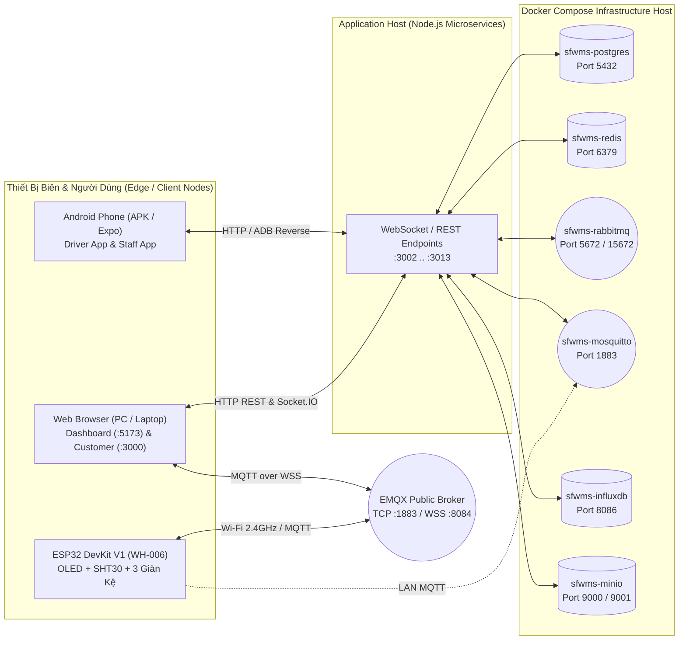

# CHƯƠNG 4: CÀI ĐẶT VÀ TRIỂN KHAI HỆ THỐNG

---

## 4.1. Môi trường phát triển và công cụ

### 4.1.1. Yêu cầu hệ thống

Để xây dựng, biên dịch và vận hành đồng thời 12 dịch vụ Backend, 4 ứng dụng Frontend/Mobile cùng các container hạ tầng và bo mạch phần cứng IoT, môi trường phát triển cần đáp ứng các thông số tối thiểu trong Bảng 4.1.

*Bảng 4.1. Yêu cầu cấu hình môi trường phát triển và vận hành*

| Thành phần | Yêu cầu tối thiểu | Khuyến nghị triển khai |
|:---|:---|:---|
| **Vi xử lý (CPU)** | 4 Cores (Intel Core i5 / AMD Ryzen 5) | 8 Cores trở lên (chạy đồng thời Docker + NodeJS Microservices) |
| **Bộ nhớ (RAM)** | 8 GB | 16 GB trở lên |
| **Ổ cứng trống** | 20 GB SSD | 40 GB NVMe SSD (lưu Docker Images, Node modules & Android SDK) |
| **Hệ điều hành** | Windows 10/11 (64-bit) hoặc Ubuntu 22.04 | Windows 11 64-bit / Linux có hỗ trợ Docker Desktop |
| **Phần cứng IoT & Di động** | Bo mạch **ESP32 DevKit V1**, cáp USB Type-C/Micro | Wi-Fi băng tần **2.4 GHz** cho ESP32; điện thoại Android bật USB Debugging (ADB) cho `Driver App` / `Staff App` |

### 4.1.2. Công cụ phát triển

Toàn bộ dự án được tổ chức theo mô hình **Monorepo** (`sfwms-monorepo`), sử dụng các công cụ và nền tảng chuẩn công nghiệp được tổng hợp ở Bảng 4.2.

*Bảng 4.2. Danh sách công cụ và thư viện phát triển chính trong hệ thống*

| Nhóm công cụ | Công cụ / Thư viện | Phiên bản / Vai trò trong dự án |
|:---|:---|:---|
| **Runtime & Backend** | Node.js, TypeScript, **NestJS**, TypeORM | Nền tảng xây dựng 12 Microservices độc lập tại `backend/services/*`. |
| **Frontend Web** | **React 19.1.4**, **Vite**, **Next.js**, `lucide-react` | `web-dashboard` (Vite) và Cổng khách hàng `customer-web` (Next.js). |
| **Đồ họa 3D & Bản đồ** | **Three.js (`0.185.1`)**, `@react-three/fiber`, `leaflet` | Dựng Bản sao số Kho 3D Digital Twin và Bản đồ giám sát đội xe. |
| **Mobile App** | **Expo (`~54.0.0`)**, React Native (`0.81.5`), **Capacitor (`8.5.3`)** | Phát triển và đóng gói file APK Android cho `driver-app` và `staff-app`. |
| **Firmware & IoT** | **PlatformIO**, Arduino Framework, `mqtt`, `PubSubClient` | Lập trình C++ và nạp firmware xuống ESP32 qua cổng USB Serial (`921600 baud`). |
| **Hạ tầng & DevOps** | **Docker**, **Docker Compose**, Git, Postman | Đóng gói 6 container hạ tầng (`postgres`, `redis`, `rabbitmq`, `mosquitto`, `influxdb`, `minio`). |

### 4.1.3. Quy trình cài đặt

Quy trình cài đặt và khởi chạy toàn bộ hệ thống từ mã nguồn gốc tại thư mục `d:\KLTN` gồm 05 bước chuẩn hóa:

1. **Bước 1 – Cài đặt thư viện toàn Monorepo:**
   ```bash
   npm run install:all
   ```
2. **Bước 2 – Khởi tạo hạ tầng Docker Containers:**
   Khởi chạy PostgreSQL, Redis, RabbitMQ, Mosquitto, InfluxDB và MinIO; script `scripts/init-db.sql` tự động khởi tạo toàn bộ các cơ sở dữ liệu và dữ liệu mẫu ban đầu:
   ```bash
   npm run infra:up
   ```
3. **Bước 3 – Khởi chạy cụm Backend Microservices:**
   Sử dụng `concurrently` để khởi chạy đồng bộ các microservices qua cổng `3004 – 3013`:
   ```bash
   npm run backend:all
   ```
4. **Bước 4 – Khởi chạy giao diện Web Dashboard & Customer Web & Mobile Apps:**
   ```bash
   npm run dashboard:start      # Web Dashboard quản trị & Kho 3D (:5173)
   npm run customer-web:start   # Cổng mua sắm khách hàng (:3000)
   npm run driver:start         # Ứng dụng di động Tài xế (:8081)
   npm run staff:start          # Ứng dụng di động Nhân viên kho (:8083)
   ```
5. **Bước 5 – Biên dịch và nạp Firmware xuống bo mạch ESP32:**
   ```bash
   platformio run --target upload --project-dir firmware/esp32-platformio
   ```

---

## 4.2. Kiến trúc triển khai hệ thống

### 4.2.1. Mô hình triển khai

Hình 4.1 thể hiện Sơ đồ triển khai (Deployment Diagram) phân tách rõ các nút thực thi: Tầng thiết bị biên tại kho lạnh (**ESP32 WH-006**), Tầng trình duyệt & thiết bị di động của người dùng, Tầng ứng dụng Backend Microservices và Cụm Container hạ tầng Docker.


*Hình 4.1. Sơ đồ triển khai hệ thống SFWMS (Deployment Architecture)*

### 4.2.2. Containerization với Docker

Toàn bộ tầng lưu trữ và truyền thông của hệ thống được định nghĩa tập trung trong tệp `docker-compose.yml` gồm 06 container độc lập kèm cơ chế `healthcheck` và `volumes` lưu trữ bền vững (Bảng 4.3).

*Bảng 4.3. Danh sách các Docker Container hạ tầng trong `docker-compose.yml`*

| Container Name | Docker Image | Cổng ánh xạ | Mục đích triển khai |
|:---|:---|:---:|:---|
| `sfwms-postgres` | `postgres:15-alpine` | `5432:5432` | Hệ quản trị CSDL quan hệ chính, gắn sẵn `scripts/init-db.sql` vào `/docker-entrypoint-initdb.d/`. |
| `sfwms-redis` | `redis:7.0-alpine` | `6379:6379` | Lưu trữ Cache phiên làm việc và kênh Pub/Sub `sensor_anomaly`. |
| `sfwms-rabbitmq` | `rabbitmq:3-management-alpine` | `5672`, `15672` | Message Broker chuẩn AMQP cho giao tiếp hướng sự kiện và giao diện quản trị Web UI (`15672`). |
| `sfwms-mosquitto` | `eclipse-mosquitto:2.0` | `1883:1883` | MQTT Broker cục bộ cấu hình `allow_anonymous true` qua `mosquitto/config/mosquitto.conf`. |
| `sfwms-influxdb` | `influxdb:2.7-alpine` | `8086:8086` | CSDL chuỗi thời gian với Org `sfwms` và Bucket `sensor_data` lưu lịch sử nhiệt ẩm kho lạnh. |
| `sfwms-minio` | `minio/minio:latest` | `9000`, `9001` | Object Storage chuẩn S3 lưu tệp báo cáo, chứng từ và ảnh e-POD. |

### 4.2.3. Truyền thông giữa các Service

Hệ thống kết hợp 04 cơ chế giao tiếp tùy theo tính chất nghiệp vụ để tối ưu cả độ trễ lẫn độ tin cậy:
1. **HTTP RESTful API:** Phục vụ giao tiếp đồng bộ giữa các ứng dụng Frontend/Mobile với các Microservices (xác thực JWT, tạo đơn hàng, tra cứu tồn kho, giải bài toán VRP).
2. **RabbitMQ (AMQP Event Bus):** Truyền tải bất đồng bộ các sự kiện nghiệp vụ giữa `order-service`, `inventory-service`, `inbound-service`, `outbound-service` và `notification-service` nhằm giảm sự phụ thuộc cứng (Loose Coupling).
3. **Redis Pub/Sub:** Kênh `sensor_anomaly` truyền cảnh báo tức thời từ `iot-service` sang `ai-service` để tái đánh giá rủi ro lô hàng ngay khi nhiệt độ kho mát vượt ngưỡng.
4. **Socket.IO & MQTT over WebSocket (`wss://broker.emqx.io:8084/mqtt`):** Đẩy cập nhật đơn hàng tức thời qua `OrderGateway` và kết nối hai chiều trực tiếp từ Web Dashboard đến phần cứng **ESP32 WH-006**.

### 4.2.4. Database Architecture (Database-per-Service & Time-Series)

Mỗi microservice sở hữu một schema/database riêng trên PostgreSQL 15 (khởi tạo trong `init-db.sql`), đảm bảo dịch vụ này không truy vấn trực tiếp vào bảng của dịch vụ khác:
* **CSDL Quan hệ (PostgreSQL 15):** `sfwms_auth`, `sfwms_product`, `sfwms_inventory`, `sfwms_warehouse`, `sfwms_order`, `sfwms_inbound`, `sfwms_outbound`, `sfwms_transport`, `sfwms_report`, `sfwms_iot`.
* **CSDL Chuỗi thời gian (InfluxDB 2.7):** Dữ liệu cảm biến SHT30 (nhiệt độ, độ ẩm theo thời gian thực) được ghi vào Bucket `sensor_data` giúp truy vấn biểu đồ lịch sử và phát hiện xu hướng quá nhiệt nhanh chóng.

### 4.2.5. Caching & Real-time Strategy

* **Pre-computed Forecast Cache (`inbound-service`):** Kết quả dự báo Holt-Winters và Bayesian Cold-Start của từng kho được lưu trong `cachedForecastMap` với **TTL = 2 giờ** (`CACHE_TTL_MS = 2 * 60 * 60 * 1000`), giúp API `GET /inbound-orders/ai-forecast` phản hồi tức thì `< 50 ms` và hỗ trợ nút trigger chạy lại (`POST /inbound-orders/ai-forecast/recalculate`) khi có biến động đơn đột xuất.
* **JWT Token Caching trong `AiService`:** Giữ sẵn Bearer Token trong bộ nhớ và chỉ làm mới khi còn dưới 5 phút trước thời điểm hết hạn để tối ưu hiệu năng khi gọi liên hoàn sang `inventory-service`.
* **Auto-Reconnect MQTT Hook (`useMqtt.ts`):** Hook phía trình duyệt thiết lập `reconnectPeriod: 4000`, `qos: 1` và xử lý tương thích ES Module/CommonJS giúp kết nối đến bo mạch ESP32 không bị gián đoạn khi mạng chập chờn.

---

## 4.3. Các module chức năng chính

### 4.3.1. Identity & User Service (`user-service` - Port 3012)

Chịu trách nhiệm xác thực và quản trị truy cập toàn hệ thống:
* **Xác thực JWT & Mã hóa Bcrypt:** Cung cấp endpoint đăng nhập (`/auth/login`), băm mật khẩu người dùng an toàn và cấp phát token mang `userId`, `email`, `role`.
* **Phân quyền RBAC (`JwtAuthGuard` & `RolesGuard`):** Bảo vệ tất cả các endpoint trên 12 services theo 06 vai trò (`ADMIN`, `WAREHOUSE_MANAGER`, `WAREHOUSE_STAFF`, `SALES_STAFF`, `DRIVER`, `CUSTOMER`).
* **Audit Log & System Settings:** Ghi lại lịch sử thao tác quản trị (`audit-log.entity.ts`) và lưu cấu hình vận hành hệ thống (`system-setting.entity.ts`).

### 4.3.2. Warehouse, Product & Inventory Service (`warehouse`, `product`, `inventory`)

Quản lý không gian lưu trữ **02 phân khu (Kho Mát `COLD` và Kho Thường `DRY`)** và kiểm soát hạn sử dụng:
* **`warehouse-service` (:3005):** Quản lý cấu trúc phân cấp `Warehouse` $\rightarrow$ `Zone` (`COLD`, `DRY`) $\rightarrow$ `Shelf` (ví dụ `Kệ A1`, `Kệ A2`, `Kệ A3`) $\rightarrow$ `StorageSlot` (tọa độ `row`, `position`, tải trọng `max_weight_kg`).
* **`product-service` (:3010):** Quản lý danh mục `Product` và `Category` kèm thông số bảo quản chuẩn (`storage_type`: `COLD` hoặc `DRY`, `min_temp`, `max_temp`, `max_humidity`).
* **`inventory-service` (:3011):** Quản lý vòng đời lô hàng `Lot` theo nguyên tắc **FEFO**, ghi vết `StockMovement`, tích hợp **Transactional Outbox** (`outbox.entity.ts`) và module **`MLSpoilageService`** đánh giá rủi ro hư hỏng theo mô hình Arrhenius Kinetic ($Q_{10}$, `estimatedDaysToSpoil`, `mlRiskScore`).

### 4.3.3. Order, Inbound & Outbound Service (`order`, `inbound`, `outbound`)

Điều phối toàn bộ luồng luân chuyển đơn hàng vào/ra kho:
* **`order-service` (:3004):** Quản lý thực thể `Order` với 12 trạng thái (`PENDING` $\rightarrow$ `PROCESSING` $\rightarrow$ `PICKING` $\rightarrow$ `PACKING` $\rightarrow$ `PACKED` $\rightarrow$ `CONFIRMED` $\rightarrow$ `READY_FOR_DELIVERY` $\rightarrow$ `DELIVERING` $\rightarrow$ `COMPLETED`, cùng nhánh ngoại lệ `FAILED_DELIVERY` $\rightarrow$ `RETURN_TO_WAREHOUSE`), tọa độ GPS khách hàng và `OrderGateway` WebSocket.
* **`inbound-service` (:3006):** Quản lý phiếu nhập kho chuẩn **Mẫu 01-VT** (`InboundOrder`), kiểm định chất lượng đầu vào (`QualityCheck`) và động cơ dự báo nhu cầu **`MLDemandForecastingService`**.
* **`outbound-service` (:3007):** Quản lý phiếu xuất kho (`OutboundOrder`), gắn thông tin tài xế bàn giao (`assignedDriverId`, `assignedDriverPlate`) và tiếp nhận trạng thái hoàn tất soạn hàng.

### 4.3.4. IoT Data Monitoring & AI Risk Service (`iot-service` :3002 & `ai-service` :3003)

* **`iot-service`:** Lắng nghe gói tin nhiệt độ/độ ẩm từ cảm biến **SHT30** trên mạch ESP32 (`WH-006`), lưu `SensorReading` vào CSDL và phát cảnh báo lên kênh Redis `sensor_anomaly` nếu vượt ngưỡng an toàn (Kho Mát: `0°C – +4.5°C`).
* **`ai-service`:** Đăng ký lắng nghe kênh `sensor_anomaly` từ Redis; khi nhận được sự cố quá nhiệt kéo dài $\Delta t_{\text{min}}$ phút, tự động lấy danh sách các lô hàng đang lưu tại vùng kho tương ứng và gọi API `PUT /inventory/lots/:id/risk` để tăng `riskScore` và chuyển trạng thái lô sang `AT_RISK`.

### 4.3.5. Spatial Routing & Transport Service (`transport-service` :3013 & `report-service` :3008)

* **`transport-service`:**
  * `solveVrp()`: Thực thi thuật toán **Clarke-Wright Savings** từ Depot Gò Vấp, gộp tuyến theo tải trọng và phân công xe lạnh `REFRIGERATED` (cho đơn chứa hàng Kho Mát) hoặc xe thường `NORMAL` (cho đơn Kho Thường).
  * `getInboundSchedule()`: Lập lịch bến nhập hàng (Dock Scheduling) tự động phát hiện và dời khung giờ trùng lặp giữa các nhà cung cấp trên Dock 1 và Dock 2.
  * `get3plQuote()`: Tính cước ước lượng khi thuê ngoài đối tác vận chuyển (`GHN` – Giao Hàng Nhanh, `AHAMOVE` – Giao Siêu Tốc).
* **`report-service`:** Tổng hợp dữ liệu báo cáo tồn kho, tỷ lệ hàng cận date được cứu kịp thời, doanh thu và chứng từ kế toán.

---

## 4.4. Tích hợp các dịch vụ và thư viện bên ngoài

### 4.4.1. Three.js & React Three Fiber Integration (Bản sao số Kho 3D Digital Twin)

Để trực quan hóa không gian kho hàng, hệ thống tích hợp **Three.js (`0.185.1`)** và **`@react-three/fiber`** trong thành phần `Supermarket3DScene.tsx` và `Warehouse3DDigitalTwin.tsx`:
* Dựng mô hình 3D WebGL chia làm **02 phân khu nhiệt độ (`COOL` – Kho Mát và `DRY` – Kho Thường)** với đầy đủ các dãy kệ nhiều tầng (`Kệ A1 – Thịt tươi`, `Kệ A2 – Sữa`, `Kệ A3 – Rau`...).
* Tô màu từng kiện hàng theo mức rủi ro thực tế (`SAFE`, `WARNING`, `DANGER`), hỗ trợ xoay `OrbitControls`, chuyển nhanh 5 góc nhìn (`ISOMETRIC`, `RACK_FRONT`, `RACK_BACK`, `TOP_DOWN`, `AISLE`), kéo thả điều chỉnh vị trí kệ trên sàn 3D và tìm kiếm phát sáng vị trí lô hàng theo mã SKU.

### 4.4.2. Goong / Google Maps & Leaflet GIS Integration

* **Trên Web Dashboard (`ControlTowerMap.tsx`):** Tích hợp thư viện **Leaflet (`1.9.4`)** kết hợp lớp bản đồ chi tiết khu vực TP. Hồ Chí Minh để hiển thị Tháp điều khiển đội xe, điểm xuất phát Depot Gò Vấp, lộ trình đa điểm VRP và nhiệt độ thùng xe theo thời gian thực.
* **Trên Ứng dụng Tài xế (`GoongDriverLiveMap.tsx`):** Tích hợp bản đồ trực tuyến qua `react-native-webview` sử dụng Google Maps / Goong tiles để dẫn đường cho tài xế tới từng tọa độ khách hàng trên điện thoại Android.

### 4.4.3. EMQX / Mosquitto MQTT Broker & Hệ thống mã vạch Barcode/QR Integration

* **Tích hợp MQTT hai chiều (`useMqtt.ts` + Firmware ESP32 `main.cpp`):**
  * Web Dashboard kết nối trực tiếp tới EMQX Broker thông qua giao thức WebSocket bảo mật (`wss://broker.emqx.io:8084/mqtt`), cho phép nút **"Bật Đèn Kệ (ESP32)"** trong giao diện Kho 3D phát lệnh `LOCATE` xuống phần cứng ngay lập tức và nhận lại phản hồi `CONFIRMED` khi nhân viên bấm nút vật lý **`STOP`** trên sa bàn.
  * Mô hình phần cứng sa bàn 2 tầng thực tế đã hoàn thiện (Hình 4.2) với đầy đủ **ESP32 DevKit V1**, màn hình **OLED 0.96"**, cảm biến **SHT30** và **3 Giàn kệ A1 – A2 – A3**.
* **Tích hợp sinh và quét mã vạch (`@zxing/library` & `Code128`):** Tự động tạo mã vạch `Code128` và `QR Code` cho từng `lot_code` trên giao diện Kho 3D để nhân viên dùng `Staff App` hoặc `BarcodeQRScannerModal.tsx` quét kiểm kê và xác nhận xuất kho chính xác.


*Hình 4.2. Mô hình sa bàn kho lạnh 2 tầng thực tế CityMart WH-006 tích hợp ESP32, OLED, SHT30 và 3 giàn Pick-to-Light*
