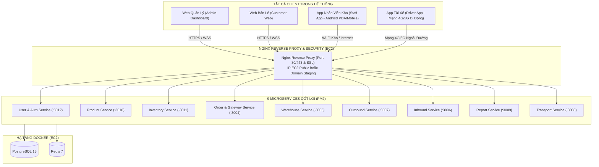

# KẾ HOẠCH RÀ SOÁT BACKEND & DATABASE TRIỂN KHAI LÊN AWS EC2 (GIAI ĐOẠN TEST DEPLOY)

> **NGUYÊN TẮC CỐT LÕI (MULTI-CLIENT & DUAL-RUN)**:
> 1. **Phục vụ toàn diện mọi Client**: Backend trên EC2 sẵn sàng phục vụ **Web Quản lý (Web Dashboard)**, **Web Khách hàng (Customer Web)**, và đặc biệt là **2 Ứng dụng Di động (Staff App & Driver App)**.
> 2. **Bảo toàn 100% môi trường Local**: Việc chuẩn bị deploy không làm gián đoạn hay thay đổi cách bạn chạy local (`npm run backend:fast`, `npm run infra:up`).
> 3. **Tinh gọn tối đa cho giai đoạn Test Deploy**: Giữ đúng 9 services cốt lõi, loại bỏ dịch vụ dư thừa, tạm hoãn phần cứng IoT thật (chờ 1 tuần nữa).

---

## 1. MÔ HÌNH KẾT NỐI TOÀN BỘ HỆ SINH THÁI TỚI EC2



---

## 2. RÀ SOÁT ĐẶC THÙ CHO 2 ỨNG DỤNG DI ĐỘNG (MOBILE APPS)

### 2.1. Yêu cầu kết nối mạng của Mobile Apps khi lên EC2
Khác với Web chạy trên cùng máy tính, 2 ứng dụng di động có đặc thù riêng:
- **Staff App (Nhân viên kho)**: Dùng máy quét PDA hoặc điện thoại Android tại kho (kết nối Wi-Fi hoặc 4G) để quét mã vạch nhận hàng, xuất kho, kiểm kê.
- **Driver App (Tài xế giao hàng)**: Chạy trên smartphone của tài xế di chuyển khắp TP.HCM qua mạng **4G/5G**, **tuyệt đối không thể kết nối tới `localhost` hay IP mạng nội bộ Wi-Fi (`192.168.x.x`)**.
- **Giải pháp**:
  - Backend trên EC2 phải có **Public IP** (Elastic IP) hoặc gán Domain Staging (VD: `api.smartwarehouse.vn` hoặc dùng Dynamic DNS miễn phí như DuckDNS: `sfwms-api.duckdns.org`).
  - Nginx mở cổng HTTPS (hoặc HTTP cho phép Cleartext) để 2 App gọi vào.

### 2.2. Danh mục API 2 Mobile App cần giao tiếp trên EC2

| Ứng dụng | Các Microservices cần kết nối | Nghiệp vụ thời gian thực |
| :--- | :--- | :--- |
| **Driver App** *(Tài xế)* | 1. `order-service` (`:3004`)<br/>2. `outbound-service` (`:3007`)<br/>3. `user-service` (`:3012`) | - Nhận danh sách đơn cần giao.<br/>- Báo cáo trạng thái (Đang giao, Hoàn tất POD, Hàng hoàn).<br/>- Gửi tọa độ GPS di chuyển và nhiệt độ thùng xe lạnh (`/orders/telemetry`).<br/>- Tải ảnh chụp POD lên Amazon S3. |
| **Staff App** *(Nhân viên kho)* | 1. `inbound-service` (`:3006`)<br/>2. `outbound-service` (`:3007`)<br/>3. `inventory-service` (`:3011`)<br/>4. `user-service` (`:3012`)<br/>5. `order-service` (`:3004`) | - Nhận hàng NCC, kiểm đếm SKU.<br/>- Lấy hàng Pick-to-Light theo kệ.<br/>- Đóng gói đơn xuất kho.<br/>- Kiểm kê, tra cứu tồn kho theo lô/kệ.<br/>- Nhận thông báo âm thanh / push alert khi có đơn khẩn. |

### 2.3. Cấu hình Chuyển Đổi Host Mềm Dẻo (Local vs EC2) trên Mobile Apps
Cả 2 App đều đã có sẵn cơ chế cấu hình Host động:
- **Staff App**: Sử dụng `networkConfig.ts`. Khi test với EC2, bạn chỉ cần gán biến môi trường `VITE_BACKEND_HOST=<EC2_PUBLIC_IP_HOAC_DOMAIN>` khi build APK hoặc lưu vào `localStorage`.
- **Driver App**: Sử dụng `api.ts`. Khi test với EC2, đổi `DEFAULT_LAN_IP` hoặc lưu `sfwms_driver_host` thành IP EC2.

### 2.4. Lưu ý về Quyền Android Cleartext Traffic (HTTP vs HTTPS)
- Android 9+ mặc định chặn request HTTP thường.
- **Khuyến nghị tốt nhất**: Cài đặt SSL miễn phí qua Certbot trên EC2 (`https://api.yourdomain.com`). Khi đó cả Web và 2 App đều kết nối qua HTTPS/WSS an toàn, không bị nhà mạng 4G/Android chặn gói tin.
- **Nếu dùng tạm IP EC2 qua HTTP**: Kiểm tra file `android/app/src/main/AndroidManifest.xml` của cả Staff App và Driver App đã có thuộc tính:
  ```xml
  <application android:usesCleartextTraffic="true" ...>
  ```

---

## 3. RÀ SOÁT DANH MỤC MICROSERVICES TRÊN EC2

| STT | Microservice | Cổng | Phục vụ Web | Phục vụ Staff App | Phục vụ Driver App | Trạng thái EC2 |
| :---: | :--- | :---: | :---: | :---: | :---: | :---: |
| 1 | **user-service** | `3012` | Có | Có (Đăng nhập kho) | Có (Đăng nhập tài xế) | **Bắt buộc** |
| 2 | **product-service** | `3010` | Có | Có (Tra cứu SP) | Không | **Bắt buộc** |
| 3 | **inventory-service**| `3011` | Có | Có (Kiểm kê/Lô) | Không | **Bắt buộc** |
| 4 | **order-service** | `3004` | Có | Có (Alert đơn) | **Cốt lõi (VRP, GPS, POD)** | **Bắt buộc** |
| 5 | **warehouse-service**| `3005` | Có | Có (Vị trí kệ) | Có (Kho xuất phát) | **Bắt buộc** |
| 6 | **outbound-service** | `3007` | Có | **Cốt lõi (Pick/Pack)** | **Cốt lõi (Nhận hàng)** | **Bắt buộc** |
| 7 | **inbound-service**  | `3006` | Có | **Cốt lõi (Nhập hàng)**| Không | **Bắt buộc** |
| 8 | **report-service**   | `3009` | Có | Không | Không | **Bắt buộc** |
| 9 | **transport-service**| `3008` | Có | Không | Có (Đội xe) | **Bắt buộc** |

*(Tạm hoãn các dịch vụ dư thừa/demo: `iot-service`, `mosquitto`, `influxdb` chờ 1 tuần nữa khi có cảm biến thật; các service `picking`, `packing`, `delivery`, `tracking`, `notification` đã được gộp hoàn chỉnh vào 9 services trên).*

---

## 4. HẠ TẦNG DOCKER TINH GỌN TRÊN EC2 (DÀNH CHO GIAI ĐOẠN TEST)

Trên server EC2, tạo file `docker-compose.test.yml` siêu nhẹ:

```yaml
version: '3.8'

services:
  # 1. Cơ sở dữ liệu chính
  postgres:
    image: postgres:15-alpine
    container_name: sfwms-postgres-test
    restart: always
    environment:
      POSTGRES_USER: postgres
      POSTGRES_PASSWORD: ${DB_PASSWORD:-postgres}
      POSTGRES_DB: postgres
    ports:
      - "127.0.0.1:5432:5432" # Chỉ cho phép localhost trên EC2 truy cập, không mở ra Internet
    volumes:
      - ./postgres_data:/var/lib/postgresql/data
      - ./scripts/init-db.sql:/docker-entrypoint-initdb.d/init-db.sql

  # 2. Redis Caching & Pub/Sub
  redis:
    image: redis:7.0-alpine
    container_name: sfwms-redis-test
    restart: always
    ports:
      - "127.0.0.1:6379:6379"
    volumes:
      - ./redis_data:/data

  # 3. RabbitMQ Event Bus (Tùy chọn)
  rabbitmq:
    image: rabbitmq:3-management-alpine
    container_name: sfwms-rabbitmq-test
    restart: always
    ports:
      - "127.0.0.1:5672:5672"
      - "127.0.0.1:15672:15672"
    environment:
      RABBITMQ_DEFAULT_USER: guest
      RABBITMQ_DEFAULT_PASS: guest
    volumes:
      - ./rabbitmq_data:/var/lib/rabbitmq
```

---

## 5. QUY TRÌNH THỰC HIỆN TEST DEPLOY (BẢO TOÀN LOCAL)

### Bước 1: Rà soát biến môi trường tại Local (Đảm bảo Zero-Config)
- Đảm bảo trong mã nguồn: Mọi kết nối đều có fallback `localhost`:
  - `process.env.DB_HOST || 'localhost'`
  - `process.env.INTERNAL_PRODUCT_URL || 'http://localhost:3010'`
- Bạn vẫn gõ `npm run backend:fast` trên máy local bình thường mà không cần sửa bất cứ file nào.

### Bước 2: Thiết lập EC2 siêu tiết kiệm (Gói t3.small là đủ)
- Do đã bỏ bớt các service dư thừa, bạn chỉ cần chọn gói **t3.small (2 vCPU, 2GB RAM)** có chi phí rất thấp (~0.0208 USD/giờ, khoảng 15.000 VNĐ/ngày).
- Thiết lập **2GB - 4GB Swapfile** để hệ thống vận hành mượt mà.

### Bước 3: Cấu hình PM2 chạy đúng 9 Service cốt lõi
- Tạo file `ecosystem.config.js` trên EC2 chỉ chứa đúng 9 services cần thiết (`user`, `product`, `inventory`, `order`, `warehouse`, `outbound`, `inbound`, `report`, `transport`).
- Lệnh chạy: `pm2 start ecosystem.config.js`.

### Bước 4: Kiểm thử E2E từ xa
1. **Kiểm thử Web Admin & Khách hàng**: Đăng nhập, đặt đơn hàng, cập nhật trạng thái realtime.
2. **Kiểm thử Staff App trên điện thoại Android**:
   - Nhân viên quét mã nhận hàng Inbound -> Kho tự động tăng số lượng lô trên EC2.
   - Nhân viên lấy hàng Outbound theo chỉ dẫn kệ -> Hệ thống trừ tồn kho.
3. **Kiểm thử Driver App trên mạng 4G**:
   - Tài xế bật mạng di động 4G ngoài đường, đăng nhập nhận chuyến giao hàng từ EC2.
   - Bấm "Bắt đầu giao" -> Tọa độ GPS của tài xế hiển thị thời gian thực trên bản đồ Web Admin (`/orders/drivers-live`).
   - Chụp ảnh giao hàng thành công (POD) -> Ảnh lưu lên Amazon S3 và đơn chuyển trạng thái `COMPLETED` realtime trên Web Admin.

